# GHCPSpendTray

**Keep an eye on your GitHub Copilot usage without opening a browser.**
See personal and work accounts from your Windows tray or Mac menu bar, set
your own budgets, and spot when you're on course to go over them.

[Install](#install) &middot; [Add accounts](#add-your-accounts) &middot;
[Set budgets](#set-your-own-budget) &middot; [Read your usage](#understand-your-usage-at-a-glance) &middot;
[Updates](#keep-the-app-up-to-date)

  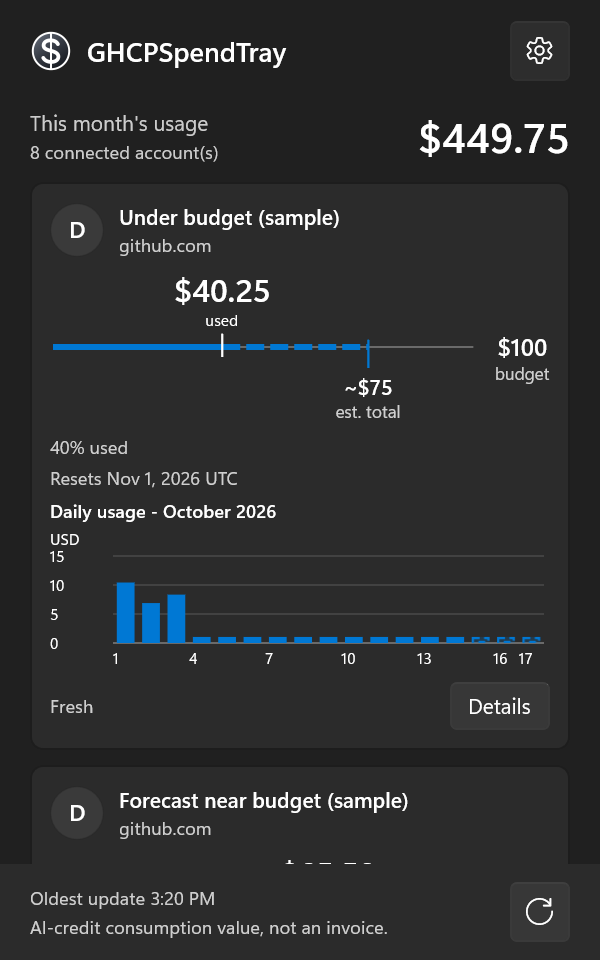
  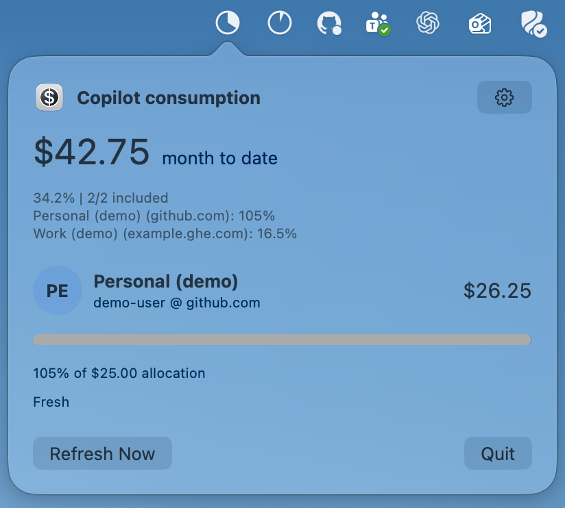

*App screenshots use synthetic accounts and amounts. Settings screenshots below
are from Windows unless labeled otherwise; the same core settings are available on Mac.*

## Install

### Windows: Microsoft Store (recommended)

1. [Get GHCPSpendTray from the Microsoft Store](https://www.microsoft.com/store/productId/9PMX96TSF295).
2. Launch it from **Start**.
3. Click its notification-area icon to open your usage; the gear opens **Settings**.

Requires **Windows 11 22H2 or newer**, x64 or ARM64. No separate .NET runtime is
needed. Can't use the Store? See [standalone installation](docs/WINDOWS-INSTALL.md).

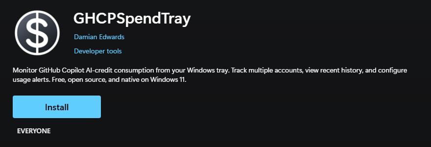

### macOS: download and drag to Applications

1. Open the [macOS releases](https://github.com/DamianEdwards/ghcp-spend-tray/releases?q=macos)
   and download `GHCPSpendTray-macOS-<version>.dmg`.
2. Open the disk image and drag **GHCPSpendTray** to **Applications**.
3. Launch it and click its menu-bar icon. It doesn't keep a Dock icon.

Requires **Apple silicon** and the latest patches of **macOS 26 or 15**.
Use signed, notarized public releases; don't bypass macOS security warnings.

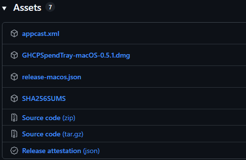

## Add your accounts

Open **Settings > Accounts > Add account**. Repeat to track both personal and
work identities, including multiple accounts on the same host.

### GitHub.com

A sign-in code is generated and copied automatically. Choose **Open browser**
(**Open Authorization Page** on Mac), paste the code on GitHub, and authorize
the app. Return here: your account is added automatically.

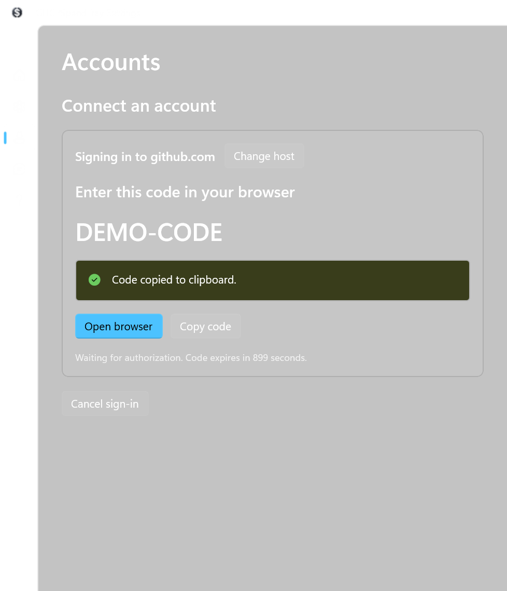

### Work accounts on a custom `ghe.com` host

Choose **Change host**, select **Custom...**, and enter your organization's
hostname, such as `example.ghe.com`. Check the displayed sign-in and API
destinations, then choose **Start sign-in**.

`msft.ghe.com` has a built-in OAuth registration. Other custom hosts need an
approved, host-specific **OAuth Client ID** with Device Flow enabled.
Your administrator may need to approve access.
[More about enterprise sign-in](docs/USER-GUIDE.md#enterprise-sign-in).

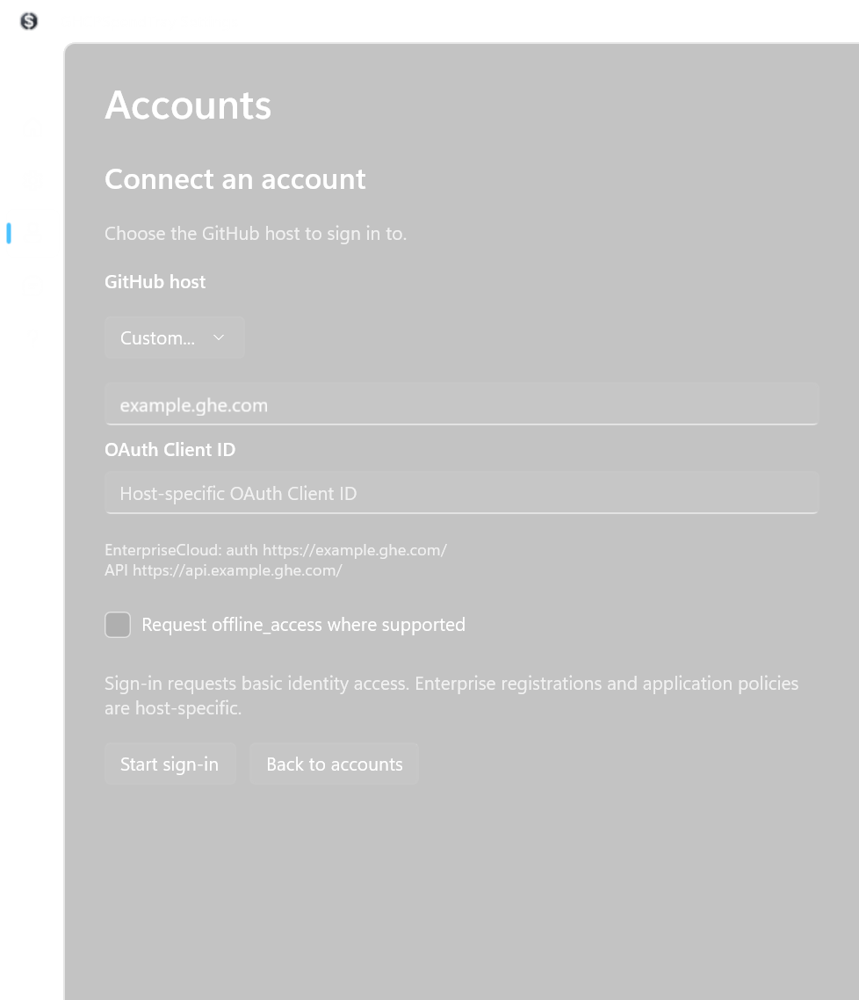

## Set your own budget

Want to track against $100 rather than the limit GitHub reports?

1. Open **Settings > Accounts**, then **Manage** (**Manage account** on Mac).
2. Under **Usage budget**, choose **Use a custom budget** and enter a USD amount.
3. Choose **Save account** (**Save** on Mac).

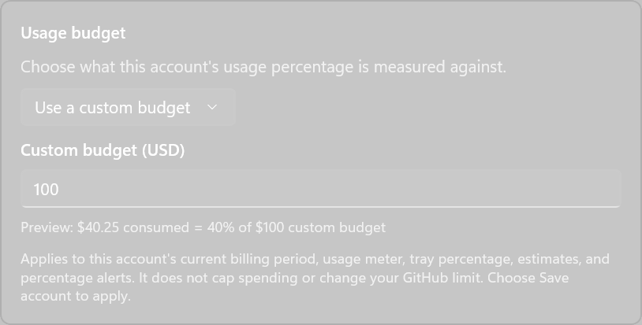

Your budget drives the usage percentage, tray icon, estimated excess, and
percentage alerts for that account. **It's a tracking target, not a spending
cap**: it doesn't change your GitHub quota or stop consumption. Choose the API
limit option and save to remove the override.

## Enable end-of-period estimates

In the same account settings, enable **Show estimated period consumption** and
save. It's off by default and is enabled separately for each account.

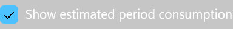

The **solid line and "used" amount are actual usage**. The **dashed extension
and "est. total" amount are the forecast** at reset, assuming your usage pace
continues. The target on the right is labeled **budget** or **API limit**.
Estimates don't change actual usage or trigger forecast-based alerts.

## Understand your usage at a glance

The same meter appears in the popup, Usage page, and account details. These
examples all have a $100 target; click an image for a closer look.

| Actual usage | Estimates off | Estimates on |
|---|---|---|
| **Under target: below 95%.** No actual-usage warning. | 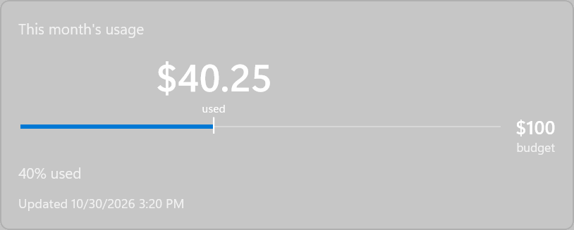 | 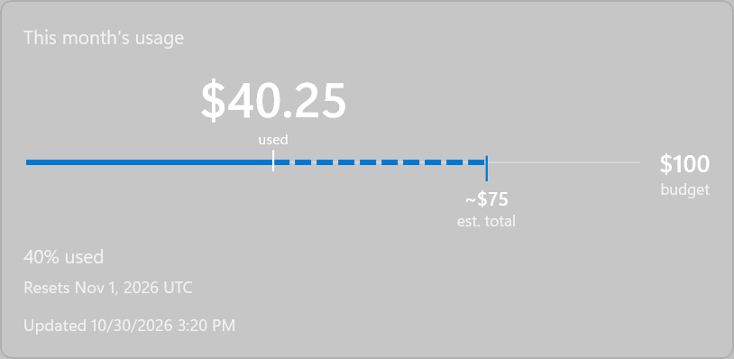 |
| **Near target: 95% to below 100%.** Warning icon beside the used amount. | 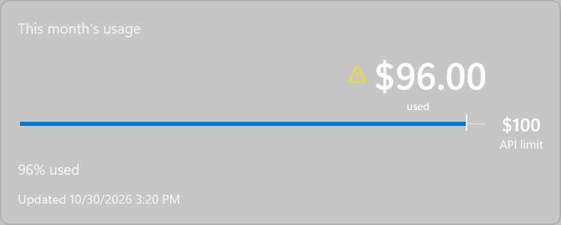 | 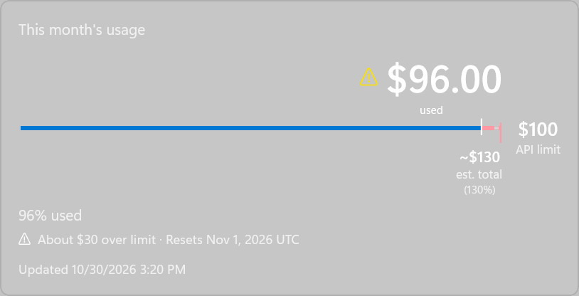 |
| **At or over target: 100% or more.** Error icon; the full amount remains visible even though the marker stops at the end. | 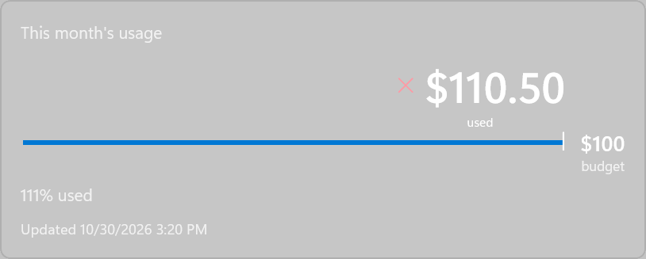 | 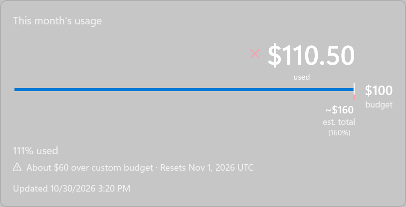 |

**A risky forecast doesn't mean you've already overspent.** Its dashed line
has its own status: accent below 95%, amber from 95% to below 100%, and red at
100% or more. Notice the absence of an actual-usage warning in both examples:

| Still under budget, forecast near budget | Still under budget, forecast over budget |
|---|---|
| 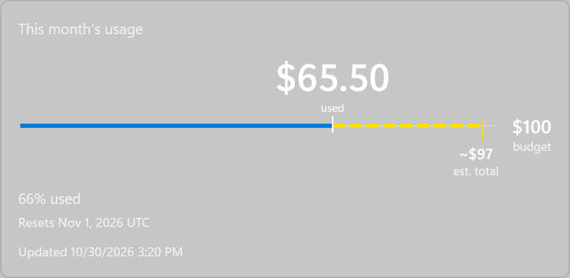 | 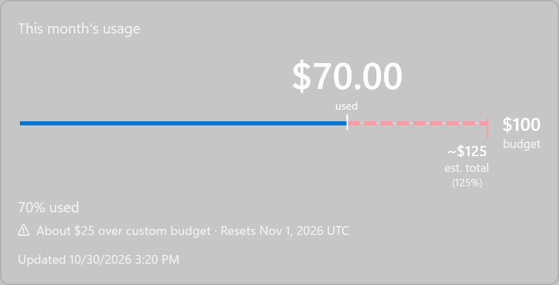 |

Estimates need enough valid current-period data; **unavailable isn't zero**.
Unlimited accounts have no percentage target unless you set a custom budget.
[See unavailable/unlimited examples and how estimates work](docs/USER-GUIDE.md#estimates-and-unavailable-data).

## Get alerts before you lose track

Open **Settings > Notifications** to enable alerts and save your choices.
The default percentage thresholds are **50%, 80%, and 100%**. Set a USD
increment, such as `50`, for alerts at $50, $100, $150, and so on.
Account settings can override the defaults.

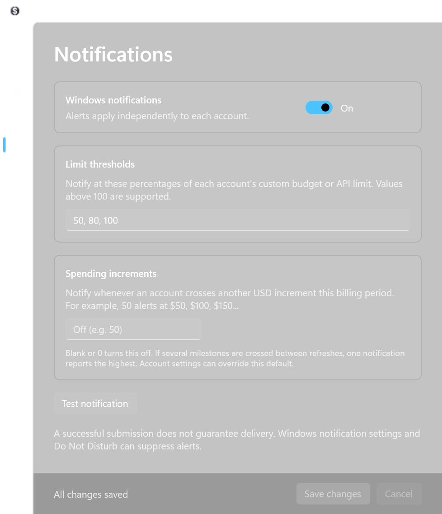

Alerts follow **actual usage**, not forecasts. On Mac, use **Enable
Notifications** to grant permission; Focus or Do Not Disturb can suppress
delivery on either platform.

## Keep the app up to date

### Windows (Microsoft Store)

Store copies check automatically. To check now, open **Settings > About**.
When an update is available, choose **Update**, approve the Windows prompt,
and let the app install and restart. If **Restart** appears, select it to finish.
An update notification also takes you directly to About.

| Ready to update | Downloading and applying |
|---|---|
| 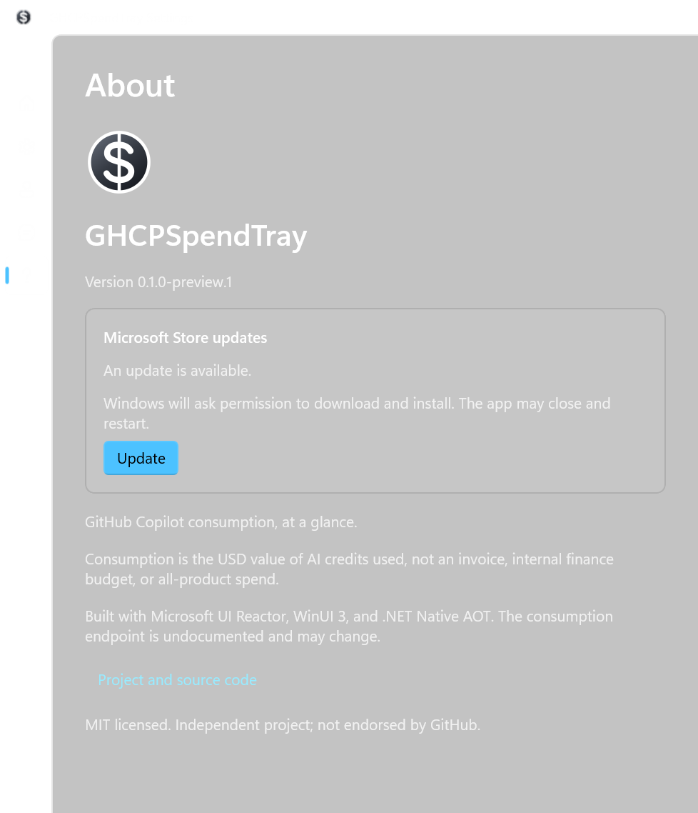 | 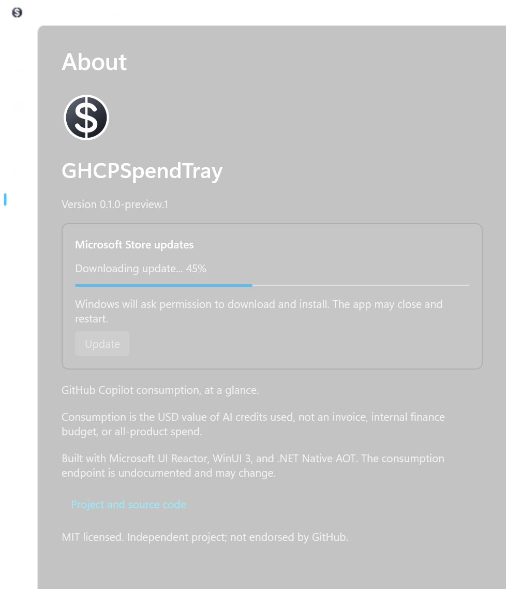 |

### macOS

Choose **Check for Updates...** from the menu-bar context menu or **Settings >
About**. In About, enable **Automatically check for updates** if you'd like
daily checks. **Automatically download and install updates on quit** is
optional; closing Settings isn't quitting the app. A downloaded update offers
**Install and Relaunch...** to apply it immediately. Automatic updates use
stable releases, including when you're running a preview.

Standalone Windows installs need a manual update:
[installation and update instructions](docs/WINDOWS-INSTALL.md#update-a-standalone-install).

## Make it work your way

In **Settings > General**, choose a pie-chart or percentage icon, a combined
roll-up or individual account icons, and which accounts to include. Check the
**Live preview**, then save. The combined percentage is weighted by each
account's budget or limit, not a simple average.

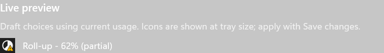

You can also enable **Start with Windows** (**Launch at login** on Mac) and change the refresh interval
(10 minutes by default). [More settings, icon meanings, and daily charts](docs/USER-GUIDE.md).

## Help, privacy, and contributing

Usage is the USD value of Copilot AI credits consumed, **not an invoice**.
The consumption API is undocumented and may be unavailable on some hosts.
Stale or unsupported data is marked unavailable rather than shown as zero.

Settings and history stay local; tokens are kept in Windows Credential Manager
or macOS Keychain. See the [privacy policy](PRIVACY.md), [troubleshooting and
removal guide](docs/USER-GUIDE.md#troubleshooting), or
[report an issue](https://github.com/DamianEdwards/ghcp-spend-tray/issues)
without sharing tokens or private usage data.

For source builds and synthetic demos, see [development](docs/DEVELOPMENT.md).
[Validation](docs/VALIDATION.md) and [releasing](docs/RELEASING.md) cover
maintainer workflows.

[MIT licensed](LICENSE). Independent project; not affiliated with or endorsed by GitHub.
