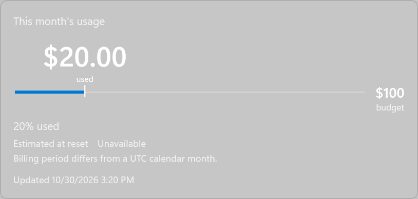
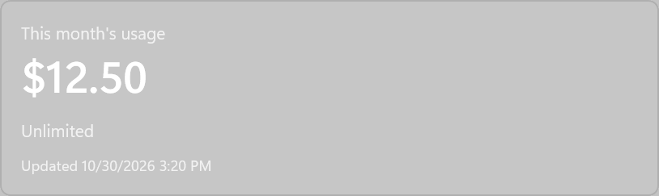
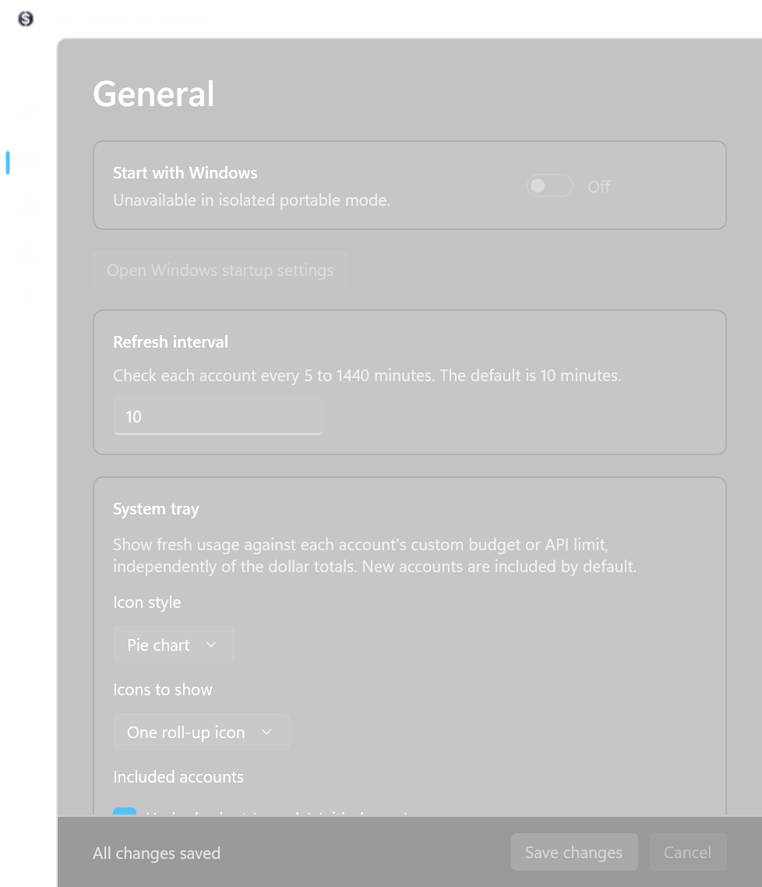
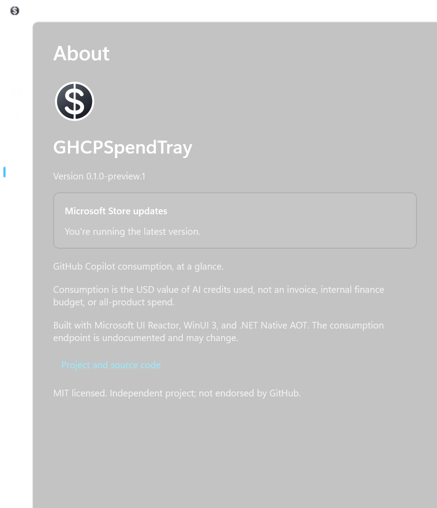

# More ways to use GHCPSpendTray

Start with the [screenshot-led quick guide](../README.md) for installation,
accounts, budgets, estimates, alerts, and updates.

## Enterprise sign-in

Each account belongs to a specific GitHub host. **Add account** always starts
with `github.com`; **Change host** cancels that attempt so you can choose
another host. **Reconnect** uses the saved host and OAuth registration and
rejects a different browser identity instead of replacing the account.

| Host | What you need |
|---|---|
| `github.com` | The built-in OAuth registration; no Client ID to supply. |
| `msft.ghe.com` | The built-in host-specific registration. Select the custom host and enter the hostname. |
| Another enterprise host, such as `example.ghe.com` | An approved OAuth app registered on that host, with Device Flow enabled. Enter its Client ID during setup. |

The app doesn't use `gh` credentials or ask for a client secret. A custom
Client ID is saved with the account for reconnect and token refresh.
Enterprise SSO, managed-user, IP, and app policies may require administrator
approval. Successful sign-in doesn't guarantee that the host provides the
Copilot consumption API.

Sign-in requests `read:user` for identity and optionally `offline_access`
for refresh tokens where supported. The consumption endpoint is undocumented;
its minimum OAuth scope hasn't been established.

If clipboard copying fails, choose **Copy code** again or copy the displayed
code yourself. **Cancel sign-in** stops the attempt; **Try again** gets a new
code. Check the host, account, and OAuth app in the browser before authorizing.

## Estimates and unavailable data

The [meter comparison](../README.md#understand-your-usage-at-a-glance) separates
actual usage from forecasts. A custom budget changes the comparison target,
not the observed usage or your GitHub quota.

**No estimate doesn't mean no consumption.** With estimates switched off,
only actual usage appears. With estimates enabled but unavailable, the app
explains why; it never substitutes a $0 forecast.

Estimates aren't available during the first 24 hours of the period and are
labeled early before 72 hours. Stale, failed, expired, or inconsistent data
can also prevent a forecast. Open **Advanced details** to inspect its method,
dates, observation time, and average daily consumption.

Where suitable daily reports exist, the forecast adds the average of up to
seven recent consecutive complete UTC days multiplied by the time remaining
to current usage. Today's partial usage and estimated chart bars aren't used.
Missing, old, or incompatible reports fall back to the period-to-date pace.
Without daily reports, the app uses that period-to-date calculation.

The forecast assumes the selected pace continues; it isn't a bill. Reset
boundaries use UTC calendar months. An incompatible supplied reset makes the
estimate unavailable; a missing reset uses the calendar-month fallback.
Actual consumption keeps its cents; estimates round to whole USD.

Unlimited accounts have no finite target by default. You can still read their
dollar consumption, enable dollar alerts, and request a dollar forecast.
Setting a custom budget gives them a percentage tracking target too.

## Tray and menu-bar icons

Use **General > System tray** on Windows or **General > Menu Bar** on Mac.
Choose a pie or percentage number, a combined roll-up or per-account icons,
and the accounts to include. Draft choices only affect **Live preview** until
you save.

The combined percentage divides eligible consumption by those same accounts'
combined limits or custom budgets. Stale, failed, unsupported, or unknown-limit
accounts aren't silently counted as zero. Unlimited accounts contribute a
percentage only when given a finite custom budget.

| Indicator | Meaning |
|---|---|
| Warning badge (triangle on Windows, `!` on Mac) | Incomplete account coverage in the roll-up, **not** a forecast overrun. |
| `?` | No usable percentage, not zero consumption. On Mac, the unavailable pie is an empty outline with `!`. |
| Infinity | Fresh unlimited usage; an unavailable account isn't shown as unlimited. |
| `+` | Usage is over the target; the pie itself stops at 100%. |
| `<1` or `999+` | A percentage below 1% or above 999%. |

Only display values are rounded; alert thresholds use unrounded values.
With mixed finite and unlimited accounts, the roll-up percentage uses the
finite accounts and identifies unlimited accounts in the details.
**Settings > Usage** explains which accounts are included and why.
These icon preferences don't filter the dollar totals.

Windows controls notification-area overflow; the app can't force its icons
to stay visible. A crowded Mac menu bar may also hide icons. Reopening the
Mac app brings Settings forward.

## Refresh, login, and saving settings

Refresh runs every 10 minutes by default; **General** accepts 5 to 1440 minutes.
Use the popup refresh button or **Refresh now** in the icon's context menu
when you want a manual refresh.

Enable **Start with Windows** (**Launch at login** on Mac) in General if desired. macOS may also require
approval in **System Settings > General > Login Items**.

Account, General, and Notifications pages have fixed Save/Cancel controls.
**Cancel** restores saved values. Leaving a changed form prompts you to save,
discard, or keep editing; invalid or failed saves leave the draft intact.

Account pictures are cached locally. **Refresh** in account management
refreshes the avatar as well as usage; initials appear if no image is
available. Removing an account removes its cached picture.

## Daily charts

Eligible Microsoft enterprise accounts can connect optional corporate daily
consumption reports from account settings. Setup uses Azure CLI authentication
and asks you to confirm the corporate identity explicitly.

These are reported daily values, not a chart inferred from periodic local
usage snapshots. Some connected accounts have no reports yet. Estimated bars
are distinguished from reported bars; neither a connected identity nor a
successful sign-in guarantees report availability.

## Notification permissions

Percentage alerts use the custom budget when set, otherwise the API limit.
Unknown-limit and unlimited accounts can still use USD-increment alerts.
Changing a budget rearms percentage alerts for the new target on the next
successful refresh, without repeating already-notified dollar milestones.

On Mac, **Notifications > macOS Permission** shows the current permission.
Choose **Enable Notifications** to request it. If access was denied earlier,
choose **Open Notification Settings**, enable **Allow Notifications**, and
return. Background refresh never opens permission prompts.

Focus, Do Not Disturb, or operating-system notification preferences may
suppress an alert even when the app submits it successfully.

## Checking updates

For Store-installed Windows copies, opening **About** checks for updates.
If no update is available, it shows the latest-version status instead of
an Update button.

On Mac, public builds use Sparkle. **About** offers automatic checking and
optional download/install-on-quit preferences. Development and demonstration
builds never check for updates. Older releases without Sparkle need one manual
upgrade: quit and replace the app in Applications. Its stable bundle identifier
preserves local settings, history, and Keychain access.

Windows and Mac versions are independent; neither migrates the other's local
data. The Mac app doesn't use the App Store.

## Troubleshooting

Check the displayed error, host destinations, and organization policy first.
Consumption uses an undocumented GitHub endpoint that may change or be
unavailable. The app marks stale or unsupported data rather than treating it
as zero; previous billing periods don't count as current consumption.

**General > Open data folder** locates settings, history, and the bounded
`logs` directory. When [reporting an issue](https://github.com/DamianEdwards/ghcp-spend-tray/issues),
include the platform, app version, and redacted error. Don't attach tokens,
device codes, unredacted configuration/history, or private consumption details.
See [validation and known limitations](VALIDATION.md) for technical constraints.

## Remove accounts or uninstall

Remove accounts **in the app before uninstalling** to delete local credentials.
Removing an account doesn't necessarily revoke the OAuth grant: use **Manage
OAuth grants** in account details or the host's application settings to revoke it.

On **Windows**, exit the app and uninstall through **Settings > Apps >
Installed apps**. Windows normally removes package-local data, but generic
Credential Manager entries can remain.

On **Mac**, disable Launch at login, remove accounts, quit, and move the app
from Applications to the Trash. This doesn't remove
`~/Library/Application Support/GHCPSpendTray` or Keychain entries.
Remove that data directory separately if desired; if credentials remain,
remove only the app's `com.damianedwards.GHCPSpendTray` service items in
Keychain Access.

See the [privacy policy](../PRIVACY.md) for retention and data handling.
